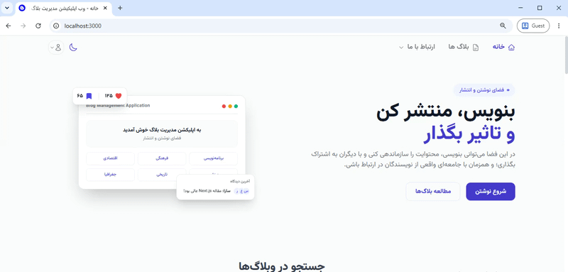
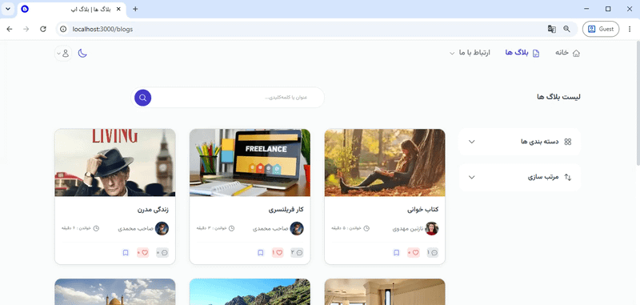
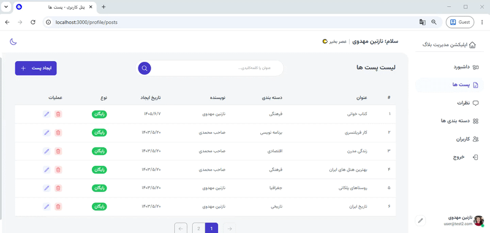

# Blog Management Application

Developed the front-end of a blog management application using Next.js (App Router), structured with
a feature-based architecture.

## Demo

**Home page and dark mode**



**Search, filter, sort, post details and comments**



**Creating a post**



## Features

- Authentication & Profile: Sign-up, sign-in, and profile management with image upload, fully validated
  on the client side; implemented silent token refresh via Axios interceptors to maintain user sessions.
- Blog Listing & Engagement: Built search, multi-category filtering, sorting (date, popularity, reading time), and pagination synced with URL search params; integrated like and bookmark features with persistent storage.
- Post Details & Comments: Created statically generated post detail pages with related posts, and engineered a nested commenting system (posting and replying) using Next.js Server Actions.
- User Dashboard: Full CRUD management for posts and categories, alongside comment status updates and deletion, using TanStack Query for efficient server state management.
- UI & UX: Built responsive, accessible interfaces with dynamic light/dark mode support, using React Suspense with skeleton fallbacks for Server Component loading states.

## Tech Stack

- Frontend: Next.js, React, TanStack Query, React Hook Form, Yup, Tailwind CSS, Framer Motion, Headless UI, Axios, next-themes, Swiper
- Backend: Node.js, Express
- Database: MongoDB

## Requirements

- Node.js
- MongoDB

## Backend

> The backend of this project was developed by Saheb Mohammadi, the instructor of the course I took. The frontend was developed by me.

<details>
<summary>Backend setup</summary>

```bash
cd backend
npm install
```

Copy `.env.example` to `.env` and fill in the values.

Load the initial data into the database:

```bash
npm run seed
```

This command creates the database and loads the data from the `data` folder, so the site starts with sample content. The `data` and `uploads` folders contain this sample data and its images.

Then run:

```bash
npm run dev
```

The backend runs on [http://localhost:5000](http://localhost:5000).

</details>

## Frontend

<details>
<summary>Frontend setup</summary>

```bash
cd frontend/start
npm install
```

Copy `.env.example` to `.env` and fill in the values. Then run:

```bash
npm run dev
```

Open [http://localhost:3000](http://localhost:3000) with your browser to see the result.

</details>
